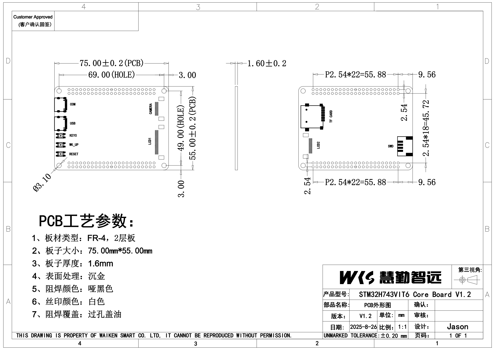

# 机械尺寸图 (Mechanical Dimensions)

> 来源 PDF：`2. 原理图/STM32H743VIT6 V1.2_机械尺寸.PDF`

页数：1

## 第 1 页

### OCR 提取文字（位号/标注，按检测顺序）

- 4  _(conf 1.00)_
- 3  _(conf 1.00)_
- >  _(conf 0.55)_
- Customer Approved  _(conf 0.98)_
- (客户确认回签)  _(conf 1.00)_
- 75.00±0.2 (PCB)  _(conf 0.98)_
- -1.60±0.2  _(conf 0.98)_
- 69. 00 (HOLE)  _(conf 0.96)_
- 3.00  _(conf 1.00)_
- —P2.54*22=55.88—  _(conf 0.97)_
- 9.56  _(conf 1.00)_
- o00000000000000000000oo  _(conf 0.53)_
- 00000000000000000000000  _(conf 0.81)_
- 00000000000000000o  _(conf 0.60)_
- -55.00±0.2 (PCB)  _(conf 0.97)_
- 2  _(conf 0.98)_
- COM  _(conf 0.99)_
- CAMERA  _(conf 1.00)_
- 49. 00 (HOLE)  _(conf 0.98)_
- CARD  _(conf 0.99)_
- . 54*18=45.  _(conf 0.93)_
- 2  _(conf 1.00)_
- USB  _(conf 1.00)_
- KEYO  _(conf 0.99)_
- WK_UP  _(conf 1.00)_
- SWD  _(conf 1.00)_
- 2  _(conf 1.00)_
- RESET  _(conf 1.00)_
- o00000000000000000o  _(conf 0.55)_
- 00000000000000000000000  _(conf 0.79)_
- 00000000000000000000000  _(conf 0.81)_
- 00000000000000000000000  _(conf 0.77)_
- 0  _(conf 0.96)_
- 9.56  _(conf 1.00)_
- 2  _(conf 1.00)_
- 3  _(conf 1.00)_
- PCB工艺参数：  _(conf 0.99)_
- 1、板材类型：FR-4，2层板  _(conf 1.00)_
- 2、板子大小：75.00mm*55.00mm  _(conf 1.00)_
- 3、板子厚度：1.6mm  _(conf 1.00)_
- 第三视角：  _(conf 1.00)_
- 4、表面处理：沉金  _(conf 1.00)_
- 5、阻焊颜色：哑黑色  _(conf 1.00)_
- 产品型号：  _(conf 1.00)_
- STM32H743VlT6 CoreBoard V1.2  _(conf 0.95)_
- A  _(conf 1.00)_
- 6、丝印颜色：白色  _(conf 1.00)_
- 部品名称：  _(conf 1.00)_
- PCB外形图  _(conf 1.00)_
- 确认：  _(conf 1.00)_
- 7、阻焊覆盖：过孔盖油  _(conf 1.00)_
- 版本：  _(conf 1.00)_
- V1.2  _(conf 1.00)_
- 单位：  _(conf 0.99)_
- mm  _(conf 1.00)_
- 审核：  _(conf 1.00)_
- 日期：  _(conf 1.00)_
- 2025-8-26比例：  _(conf 1.00)_
- 1:1  _(conf 0.99)_
- 设计：  _(conf 1.00)_
- Jason  _(conf 1.00)_
- THISDRAWINGISPROPERTYOFWAIKENSMARTCO.LTD,ITCANNOTBEREPRODUCEDWITHOUTPERMISSION.  _(conf 0.99)_
- UNMARKED  _(conf 1.00)_
- TOLERANCE:±O.20  _(conf 0.96)_
- mm  _(conf 1.00)_
- 页码：  _(conf 1.00)_
- 10F1  _(conf 0.99)_
- 4  _(conf 1.00)_
- 3  _(conf 1.00)_
- 2  _(conf 1.00)_
- 1  _(conf 1.00)_

> 共识别 71 处文字。矢量图文字以轮廓存储，OCR 可能漏识别/误识别，请以原图为准。
