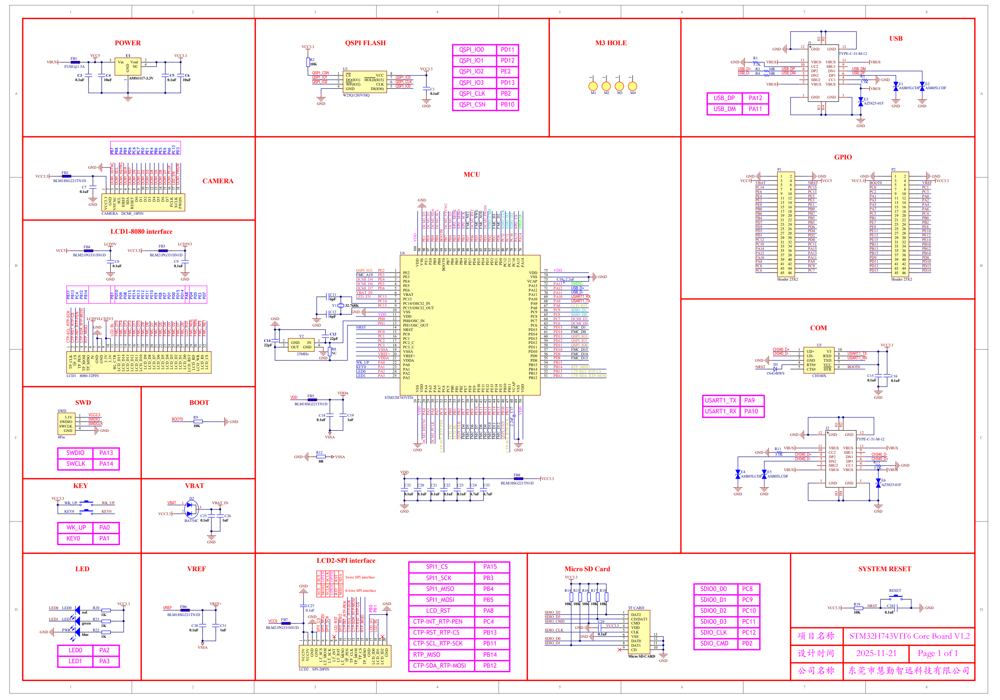

# STM32H743VIT6 V1.2 原理图 (Schematic)

> 来源 PDF：`2. 原理图/STM32H743VIT6 V1.2_SCH.pdf`（共 1 页）

## 原理图渲染图（可视参考）

> 注：下方文字由 PDF 文本层提取，密集原理图的阅读顺序被打乱，但保留了网络名/引脚映射（如 `QSPI_IO0 PD11`、`USB_D+ PA12`、`QSPI_IO2 PE2`）。精确引脚请以渲染图为准，文字用于关键词检索。

## 提取文本（按检测顺序，供检索）

|     | 1           |              |     | 2      |     |     |        | 3            |            |     |     | 4        |      | 5   |         |     | 6   |     |          | 7                  |                                    |     | 8   |     |
| --- | ----------- | ------------ | --- | ------ | --- | --- | ------ | ------------ | ---------- | --- | --- | -------- | ---- | --- | ------- | --- | --- | --- | -------- | ------------------ | ---------------------------------- | --- | --- | --- |
|     |             |              |     |        |     |     |        |              |            |     |     |          |      |     |         |     |     |     |          |                    | 1H PPIIJJ1100HH11PPIIJJ1100HH22 2H | USB |     |     |
|     |             | POWER        |     |        |     |     | VCC3.3 |              | QSPI FLASH |     |     |          |      |     | M3 HOLE |     |     |     |          | 12 J1 COJ1         | 12                                 |     |     |     |
|     |             |              |     |        |     |     |        | PPIIRR220022 |            |     |     | QSPI_IO0 | PD11 |     |         |     |     |     |          | GND PPIIJJ11001122 | GND GND                            |     |     |     |
|     | COFB1 F B 1 | VCC5 COU1 U1 |     | VCC3.3 |     |     |        | COR2         |            |     |     |          |      |     |         |     |     |     | R COR1 1 |                    | TYPE-C-31-M-12                     |     |     |     |
VBUS PPIIFFBB110011 PPIIFFBB110022 PPIIUU110033 3 Vin V ou t PPIIUU110022 2 4 R2 10K QSPI_IO1 PD12 GND PPIIRR110011 5. 1K PPIIRR110022 VBUS PPIIJJ11001111 1 1 1 0 V B U S V B U S 9 11 VBUS
FUS E @ 1.5A P PI IC C3 30 01 1 P PI IC C4 40 01 1 DNG N C PPIIUU110044 P PI IC C5 50 01 1 P PI IC C6 60 01 1 PPIIRR220011 U3 COU3 VCC3.3 QSPI_IO2 PE2 USB_D+ N L U S B 0 D 0 R3 CCOORR43P P I I R R 3 3 0 0 1 1 10R P PI IR R3 30 02 2 USB_DP PP P P II I I JJ J J 8 11 1 1 00 0 0 11 8 8 00 C D C P 2 2 S D B N U 1 1 PP PP IIII 7 JJJJ 1111 0000 7997 USB_DM N L U S B 0 D M
C COC3 3 PP II CC 33 00 22 PP II CC 44 00 22 COC4 C 4 PPIIUU110011 PP II CC 55 00 22 COC5 C 5 PP II CC 66 00 22 COC6 C 6 Q Q S S P P I I _ _ I C O S 1 N PP PP III I UUU U 1 333 3 000 0 221 1 C S V C C PP PPII I IUU U U33 8 3 300 0 077 8 8 Q S P I _ I O 3 P PII MM11 0011 P PII MM22 0011 PP IIMM3300 11 PP IIMM4400 11 USB_D- N L U S B 0 D 0 R4 P P I I R R 4 4 0 0 1 1 10R PP II RR 44 00 22 USB_DM PP P I I J J 5 1 1 0 0 5 5 D N 2 D P 1 PP PIII IJJJ 6 J111 1000 0446 6 USB_DP NL U S B R C 0 O 5 R D 5 P P P I I E E 1 1 0 0 2 2 P P I I E E 2 2 0 0 2 2
0. 1u F 10 u F 1 AMS1117-3.3V 0. 1u F 10 u F Q S P I _ I O 2 2 3 D O ( I O 1 ) HOL D ( I O 3 ) 6 7 Q S P I _ C L K P PI IC C1 10 01 1 QSPI_IO3 PD13 1 1 1 1 P II JJ 3 2 11 00 33 S B U 2 C C 1 P 2 4 PP IIRR55 00 5. 11 1K PPIIRR550022 GND COE1 COE2
P PP P I II I U UU U 4 3 33 3 0 00 0 3 44 3 W G N P D ( I O 2 ) D I( C I O L 0 K ) P P P P I I I I U U U U 5 3 3 3 3 0 0 0 0 5 6 6 5 Q S P I _ I O 0 COC1 C1 VBUS P P I I J J 1 1 0 0 2 2 V B U S V B U S VBUS E1 ASB05LCDF E2 ASB05LCDF
A W25Q128JVSIQ PP II CC 11 00 22 0.1uF QSPI_CLK PB2 M1 C O M 1 M2 C O M 2 C M3 O M 3 C M4 O M 4 1 1 P P II EE 33 00 22 P P I I E E 1 1 0 0 1 1 P P I I E E 2 2 0 0 1 1 A
|     |     |     |     |     |     |     |     |     |     |     |     |     |     |     |     |     |     | USB_DP | PA12 | PPIIJJ110011 | GND PPIIJJ1100HH33PPIIJJ1100HH44 GND | E3 COE3 |     |     |
| --- | --- | --- | --- | --- | --- | --- | --- | --- | --- | --- | --- | --- | --- | --- | --- | --- | --- | ------ | ---- | ------------ | ------------------------------------ | ------- | --- | --- |
GND GND QSPI_CSN PB10 USB_DM PA11 3H 4H PPIIEE330011 AZ5825-01F GND GND
GND
|     |     | 7 8 4 9 6 6 | 7 0 1 4 6 5 6 | 6 3 1 3 |     |     |     |     |     |     |     |     |     |     |     |     |     |     |     |     |     |     |     |     |
| --- | --- | ----------- | ------------- | ------- | --- | --- | --- | --- | --- | --- | --- | --- | --- | --- | --- | --- | --- | --- | --- | --- | --- | --- | --- | --- |
B P B P A P B P D P C P C P E P E P E P B P E P E P A P C P D P GPIO
NLDCMI0VSYNC N L DCMI0HSY N C
|     |     | GND CNYSV_IMCD NLDCMI0S C L CNYSH_IMCD N L DCMI0SDANLDCMI0RNSLTDCMI0DN0LDCMI0D1NLDCMI0NDL2DCMI0D3NLDCMI0D4NLDCMI0NDL5DCMI0D6NLDCMI0 |     | N L DCMI0PC KLCP_IMCD L K NLDCMI0PWDN NDWP_IMCD |     |     |     |     |     |     |     |     |     |     |     |     |     |     |     |     |     |     |     |     |
| --- | --- | ----------------------------------------------------------------------------------------------------------------------------------- | --- | ----------------------------------------------- | --- | --- | --- | --- | --- | --- | --- | --- | --- | --- | --- | --- | --- | --- | --- | --- | --- | --- | --- | --- |
COFB2 FB2 LCS_IMCD ADS_IMCD TSR_IMCD 0D_IMCD 1D_IMCD 2D_IMCD 3D_IMCD 4D_IMCD 5D_IMCD 6D_IMCD 7D_IMCD D 7 N L NE_DEL LED0EN MCU P1 COP1 P2 COP2
VCC3.3 PPIIFFBB220011 PPIIFFBB220022 P P I I C C 7 7 0 0 2 2 CAMERA GND PPIIPP110011 1 2 PPIIPP110022 GND GND PPIIPP220011 1 2 PPIIPP220022 GND
BLM18SG221TN1D PPIICCAAMMEERRAA0011PPIICCAAMMEERRAA0022PPIICCAAMMEERRAA0033PPIICCAAMMEERRAA0044PPIICCAAMMEERRAA0055PPIICCAAMMEERRAA0066PPIICCAAMMEERRAA0077PPIICCAAMMEERRAA0088PPIICCAAMMEERRAA0099PPIICCAAMMEERRAA001100PPIICCAAMMEERRAA001111PPIICCAAMMEERRAA001122PPIICCAAMMEERRAA001133PPIICCAAMMEERRAA001144PPIICCAAMMEERRAA001155PPIICCAAMMEERRAA001166PPIICCAAMMEERRAA001177PPIICCAAMMEERRAA001188 VCC5 V N L B V A B T ATPP PPIII IPPP P111 1000 0553 3 3 5 4 6 PP P PI IIIP PPP1 1110 0004 466 N R S T VCC5 VCC3.3 B N L O B O O OT0PP T0 P PIII IPPP P222 2000 0553 3 3 5 4 6 PP PPIII IPPP P222 2000 0664 4 V N L R V E R EF F VCC3.3
0.1uF COC7 C7 P P I I C C 7 7 0 0 1 1 1 2 3 4 5 6 7 8 9 0 1 1 1 2 1 3 1 4 1 5 1 6 1 7 1 8 1 P P NN LL E C PP EC6 6 1 14 4 PP II PP 11 00 77 7 8 P P II PP 11 00 88 P P NNLLPPCC1135 C C 1 1 3 5 P P NNLL C C PP 0 2 CC 20 P P II PP 22 00 77 7 8 PP II PP 22 00 88 P P NN LL C C PP CC 1 3 31
|     |     |     |     |     |     |     |     |     |     |     |     |     |     |     |     |     |     |     | P NNLLPPEE24 E 4 | PPPPIIIIPPPP11110000119911 9 1 1 1 1 0 2 PPPPIIIIPPPP1111000011110022NNLLPPEE35 P E | 5   | P NNLLPPAA31 A 1 PPPPIIIIPPPP22220000119911 9 1 1 | 1 1 0 2 PPPPIIIIPPPP2222000011110220NNLLPPAA20 P A 0 |     |
| --- | --- | --- | --- | --- | --- | --- | --- | --- | --- | --- | --- | --- | --- | --- | --- | --- | --- | --- | ---------------- | ----------------------------------------------------------------------------------- | --- | ------------------------------------------------- | ---------------------------------------------------- | --- |
3 . 3 C D N G C N Y L C S F E R A D S T E S 0 D 1 D 2 D 3 D 4 D 5 D 6 D 7 D K L C K L C N D W GND P NLPE0 E 2 PPIIPP11001133 1 3 1 4 PPIIPP11001144NLPE1 P E 3 P NLPA5 A 3 PPIIPP22001133 1 3 1 4 PPIIPP22001144NLPA4 P A 2
GND C V S V H E R P X P ADS_IMCD CNYSV_IMCD NLSPI10MOSINLSPI10MISONLSPI10SCK NDWP_IMCD DMC_OIDS P P NN LL B E PP BB 0 8 68 PP PII IPP P11 100 011 157 5 1 5 1 6 PP PPII II PP PP 11 11 00 00 11 11 68 86 P P NN L B E P 1 9 B 9 P P N A A LL PP 5 7 CA 57 PP PP II II PP PP 22 22 00 00 11 11 57 57 1 5 1 6 PP PP II II PP PP 22 22 00 00 11 11 68 68 P P N L A A P A 4 6 6
COCAMERA CAMERADCMI_18PIN 3D_IMCD 2D_IMCD LCS_IMCD 5D_IMCD ISOM_1IPS OSIM_1IPS KCS_1IPS 1EN_CMF TSR_IMCD EWN_CMF EON_CMF 3D_CMF 2D_CMF KLC_OIDS 3D_OIDS 2D_OIDS NLSPI10NCSLSWDCLK SC_1IPS KLCDWS P B 6 PP PP P II II I PP PP P 11 11 1 00 00 0 12 21 1 91 19 7 1 1 7 9 1 2 8 0 PP PP I I P P 1 1 0 0 2 2 0 0 P L B P 7 B 7 P N C 5 PP PP II II PP PP 22 22 00 00 12 21 91 19 1 1 7 9 1 2 8 0 PP P II I PP P 22 2 00 0 22 2 02 0 P N L C P C 4 4
|     |     |     |     |     |     |     |     |     |     |     |     |     |     |     |     |     |     |     | P P N NN L LL D B P PP B DD 4 7 4 57 | 2 1 2 2 II PP 11 00 22 22N P P N L LL B B                      | P PP 3 5 B DB 5 63 | P P N NNLL B E L PP P EE 7 1 B 79 1 2 1 | 2 2 P I P 2 0 2 2 P P N N L L B B P P B B 0 2 0 2 |     |
| --- | --- | --- | --- | --- | --- | --- | --- | --- | --- | --- | --- | --- | --- | --- | --- | --- | --- | --- | ------------------------------------ | -------------------------------------------------------------- | ------------------ | --------------------------------------- | ------------------------------------------------- | --- |
|     |     |     |     |     |     |     |     |     |     |     |     |     |     |     |     |     |     |     | P D 5                                | P P I I P P 1 1 0 0 2 2 3 3 2 3 2 4 PP II PP 11 00 22 44 P N D | 6                  | P E 9 P P I I P P 2 2 0 0 2 2 3 3 2 3   | 2 4 P P I I P P 2 2 0 0 2 2 4 4 P N L E P E 8 8   |     |
LCD1-8080 interface 0TOOB NLPC12NLPC11NLPC10 51AP 41AP P NNLLPPDD13 D 3 PP PPII IIPP PP11 1100 0022 2257 75 2 2 5 7 2 2 6 8 PP PP I I IIP P PP1 1 110 0 002 2 226 6 88 P N L D P D 4 4 P NN LL E PP 1 EE 11 1 13 PP PP II II PP PP 22 22 00 00 22 22 57 57 2 2 5 7 2 2 6 8 PP PP II II PP PP 22 22 00 00 22 22 68 68 P NN LL E PP 1 EE 0 11 02
|     |     |     |     |     |     |     |     |     |     |     | DDV 1EP 0EP 9BP | 8BP 7BP 6BP 5BP 4BP 3BP 7DP 6DP 5DP 4DP 3DP NLPD2 2DP | 1DP 0DP 21CP 11CP 01CP |     |     |     |     |     | P P C D 1 1 2 | PP II PP 11 00 22 99 2 9 3 0 P P I I P P 1 1 0 0 3 3 0 0 P P N L D D | P D 0 2 0 | P P N L E E P 1 1 E 1 3 5 5 P P I I P P 2 2 0 0 2 2 9 9 2 9 | 3 0 P P I I P P 2 2 0 0 3 3 0 0 P P N L E E P 1 1 E 2 4 1 4 |     |
| --- | --- | --- | --- | --- | --- | --- | --- | --- | --- | --- | --------------- | ----------------------------------------------------- | ---------------------- | --- | --- | --- | --- | --- | ------------- | -------------------------------------------------------------------- | --------- | ----------------------------------------------------------- | ----------------------------------------------------------- | --- |
COFB4 LCD5V FB3 COFB3 LCD3V3 PPIIUU4400110000PPIIUU44009999PPIIUU44009988PPIIUU44009977PPIIUU44009966PPIIUU44009955PPIIUU44009944PPIIUU44009933PPIIUU44009922PPIIUU44009911PPIIUU44009900PPIIUU44008899PPIIUU44008888PPIIUU44008877PPIIUU44008866PPIIUU44008855PPIIUU44008844PPIIUU44008833PPIIUU44008822PPIIUU44008811PPIIUU44008800PPIIUU44007799PPIIUU44007788PPIIUU44007777PPIIUU44007766 P C 1 0 PPPPIIIIPPPP1111000033331313 3 3 1 3 3 3 2 4 PPPPIIIIPPPP1111000033332424NLPA15 P C 1 1 P NNLLPPBB1113 B 1 1 PPPPIIIIPPPP2222000033331331 3 3 1 3 3 3 2 4 PPPPIIIIPPPP2222000033332442NNLLPPBB1102 P B 1 0
VCC5 PPIIFFBB440011 FB4 PPIIFFBB440022 VCC3.3 PPIIFFBB330011 PPIIFFBB330022 COU4 U4 0 0 1 9 9 8 9 7 9 6 9 5 9 4 9 3 9 2 9 1 9 0 9 9 8 8 8 7 8 6 8 5 8 4 8 3 8 2 8 1 8 0 8 9 7 8 7 7 7 67 P P NLPA14 A A 1 1 2 4 P P I I P P 1 1 0 0 3 3 5 5 3 5 3 6 P P I I P P 1 1 0 0 3 3 6 6 P P N L A A P 1 1 A 3 5 13 P P N L B B P 1 1 B 1 3 5 5 P P I I P P 2 2 0 0 3 3 5 5 3 5 3 6 P P I I P P 2 2 0 0 3 3 6 6 P P N L B B P 1 1 B 2 4 1 4
BLM21PG331SN1D P P I I C C 8 8 0 0 2 2 BLM21PG331SN1D P P I I C C 9 9 0 0 2 2 P A 1 0 PP PP II II PP PP 11 11 00 00 33 33 79 97 3 7 3 8 PP P II I PP P 11 1 00 0 34 3 80 8 P A 1 1 P NN D L P 9 D 9 PP PP II II PP PP 22 22 00 00 33 33 79 79 3 7 3 8 PP PP II II PP PP 22 22 00 00 34 34 80 80 P NN L D P D 8 8
P P I I C C 8 8 0 0 1 1 COC8 C8 COC9 C9 P P I I C C 9 9 0 0 1 1 D D S S V 1 E P 0 E P 9 B P 8 B P 0 T O 7 B P 6 B P 5 B P 4 B P 3 B P 7 D P 6 D P 5 D P 4 D P 3 D P 2 D P 1 D P 0 D P 2 1 C 1 1 C 0 1 C 5 1 A 41AP P N L A P A 8 8 PP P II I PP P 11 1 00 0 44 4 13 1 3 4 9 1 4 4 0 2 PP PP P I I I P P P 1 1 1 0 0 0 4 4 4 2 2 0 P A 9 P L D P 1 D 1 1 1 PP PP II II PP PP 22 22 00 00 44 44 13 13 3 4 9 1 4 4 0 2 PP PP II II PP PP 22 22 00 00 44 44 24 24 P L D P 1 D 1 0 0
B 0.1uF 0.1uF QSPI_IO2 NLQSPI0IO2 PE2 1 V OB P P P P PPIIUU44007755NLVDD 7 5 VDD P P N L C C P C 6 8 6 P I P 1 0 4 3 4 3 4 4 II PP 11 00 44 44 P P NL C C P 7 9 C 7 P P N N L L D D P P 1 1 D D 1 1 2 5 2 5 4 3 4 4 P P N N L L D D P P 1 1 D D 1 1 3 4 4 3 B
FMC_A19 PE3 PPIIUU440011 2 PE2 P E 3 V V D S D S 7 4 GND P P I I P P 1 1 0 0 4 4 5 5 4 5 4 6 P P I I P P 1 1 0 0 4 4 6 6 P P I I P P 2 2 0 0 4 4 5 5 4 5 4 6 P P I I P P 2 2 0 0 4 4 6 6
GND GND DCMI_D4 PE4 PPPPIIIIUUUU444400002323 3 P E 4 V C A P PPPPIIIIUUUU4444000077773443 7 3 C102.2uF COPPCIICC1110000022PPIICC11000011 NLSWDIO SWDIO Header 23X2 Header 23X2
|     |                                                                                                                         |                                                                                                                                   |                                                                                                                                                |                                                                                                                                       |                  |     |     |                                                             | DCMI_D6 DCMI_D7            | PE5 PE6 PPIIUU440044 4 5                                       | P E 5                                    |     |     | P A 1 3 PPIIUU44007722NLPA12 7 7 1 2 PA13 PA12                                                      | USB_D+              |     |     |     |     |     |     |     |     |     |
| --- | ----------------------------------------------------------------------------------------------------------------------- | --------------------------------------------------------------------------------------------------------------------------------- | ---------------------------------------------------------------------------------------------------------------------------------------------- | ------------------------------------------------------------------------------------------------------------------------------------- | ---------------- | --- | --- | ----------------------------------------------------------- | -------------------------- | -------------------------------------------------------------- | ---------------------------------------- | --- | --- | --------------------------------------------------------------------------------------------------- | ------------------- | --- | --- | --- | --- | --- | --- | --- | --- | --- |
|     | 11BP 31BP 4CP 21BP 41BP                                                                                                 | 1BP 01DP 9DP 8DP 51EP 41EP                                                                                                        | 31EP 21EP 11EP 01EP 9EP 8EP 7EP                                                                                                                | 1DP 0DP 51DP 41DP 8AP 4DP 5DP 3EP                                                                                                     | 7DP              |     |     | C C11 O C 1 1                                               | VBAT_IN NLVBAT0IN          | PP P P II II UU UU 44 44 6 00 00 56 56                         | P V E B 6 A T                            |     |     | P P A A 1 1 1 2 PP PP II II UU UU 7 44 44 0 00 00 77 77 01 10 PA11 NLL PP AA 11 01                  | USB_D-              |     |     |     |     |     |     |     |     |     |
|     |                                                                                                                         |                                                                                                                                   |                                                                                                                                                |                                                                                                                                       |                  |     |     | P P I I C C 1 1 1 1 0 0 1 1 P P I I 6pF C C 1 1 1 1 0 0 2 2 | P P II YY 11 00 11 LED_EN  | PC13 PC14 PP PP I I U U 4 4 7 8 0 0 7 7                        | P C 1 3                                  |     |     | P A 1 0 PP PP II II UU UU 6 6 44 44 8 9 00 00 66 66 89 98 PA10 PA9 N N L P A 9                      | USART1_RX USART1_TX |     |     |     |     |     |     |     |     |     |
|     | NL C T P0SDA0RTP0 M O S I                                                                                               |                                                                                                                                   |                                                                                                                                                |                                                                                                                                       |                  |     |     | Y1 C O Y 1                                                  | P P II YY 11 00 22 32.768K | PC15 II UU 44 9 00 88                                          | P C 1 4 / O S C 3 2 _ IN                 |     |     | P A 9 6 7 PA8                                                                                       | LCD_RST             |     |     |     |     |     |     |     |     |     |
|     | NLCTP0SCL0RTP KCS-PTR_LCS-PTC 0 S C K N L C TP0RST0RT NPL 0C CT SP NEP-PTR_TNI-PTC 0 I N T0RTP 0 P E N ISOM-PTR_ADS-PTC |                                                                                                                                   |                                                                                                                                                |                                                                                                                                       |                  |     |     | C C12 O C 1 2                                               | GND                        | P PP P P II I I I UU U U U 1 44 4 4 4 0 00 0 0 0 11 1 9 9 01 0 | P V C S 1 S 5 / O S C 3 2 _ O UT         |     |     | P P A C 9 8 PP P P PP II I I II UU U U UU 6 44 4 4 44 6 00 0 0 00 66 6 6 66 56 7 7 56 PC9 N L P C 9 | SDIO_D1             |     |     |     |     |     |     |     |     |     |
|     | SC-PTR_TSR-PTC                                                                                                          | LCD5VLCD3V3                                                                                                                       |                                                                                                                                                | NS TL F M C0 N O N LE F M C0N W E                                                                                                     | N L9 F M C0N E 1 | GND |     | P P I I C C 1 1 2 2 0 0 1 1 P P I I 6pF C C 1 1 2 2 0 0 2 2 |                            | PH0 VDD N L P H 0 P I U 1 1 4 1 2 0 1 1                        | V D D                                    |     |     | P C 8 6 6 4 5 PC8 PC7 N L P C 8                                                                     | SDIO_D0 DCMI_D1     |     |     |     |     |     |     |     |     |     |
|     |                                                                                                                         | N L L LB_DCL C D0 B L N L 51D_CMF FMC0D N 1 5L F 41D_CMF M C0D1 N 4 L 31D_CMF F M C0D 1 3 N L 21D_CMF FMC0D N 1 2L 11D_CMF F M C0 | D 1 N 1L 01D_CMF F M C0D 1 0 N 9D_CMF L FMC0D N 9L 8D_CMF F M C0D 8 N L 7D_CMF FMC0D 7 N 6D_CMF L FMC0D N 6L 5D_CMF F M C0D 5 N 4D_CMF L FMC0D | N 4L 3D_CMF F MC 0 D N 3L 2D_CMF F M C0D 2 N 1D_CMF L FMC0D N 1L 0D_CMF F M C0D 0 N L TSR_DCL LCD0R EON_CMF EWN_CMF N 91A_CMF L FMC0A | 1 1EN_CMF        |     |     | GND                                                         |                            | PH1 N L P H 1 P P I I U U 1 4 4 3 0 0 1 1 2 2                  | P P H H 0 1 / / O O S S C C _ _ O IN U T |     |     | P P C C 6 7 P P I I U U 6 4 4 3 0 0 6 6 4 4 PC6                                                     | DCMI_D0             |     |     |     |     |     |     |     |     |     |
OSIM_PTR GND PP II CC 11 33 00 22 NRST PP P P II I I UU U U 1 44 4 4 4 00 0 0 11 1 1 34 4 3 N R S T P D 1 5 PP P P II I I UU U U 6 44 4 4 2 00 0 0 66 6 6 23 3 2 PD15 FMC_D1 COM
|     |                                                                                                                                                                                |                                                                                                                                           |                                                                                                                                                                 |                                                                                                                                                                                          |                                              | PP II CC 11              | 44 00 22 Y2 COY2                       | P P I I CC 11 33 00 11 C C O 1 C 1 3 3               |     | PC0 PC1 PP PP II II UU UU 1 1 44 44 5 6 00 00 11 11 56 56 | P C 0           |     |     | P D 1 4 PP PP II II UU UU 6 6 44 44 0 1 00 00 66 66 01 01 PD14 PD13 N | FMC_D0 QSPI_IO3 L Q S P I 0 I O 3  |     |     |     |     |     |     |     |     |     |
| --- | ------------------------------------------------------------------------------------------------------------------------------------------------------------------------------ | ----------------------------------------------------------------------------------------------------------------------------------------- | --------------------------------------------------------------------------------------------------------------------------------------------------------------- | ---------------------------------------------------------------------------------------------------------------------------------------------------------------------------------------- | -------------------------------------------- | ------------------------ | -------------------------------------- | ---------------------------------------------------- | --- | --------------------------------------------------------- | --------------- | --- | --- | --------------------------------------------------------------------- | ---------------------------------- | --- | --- | --- | --- | --- | --- | --- | --- | --- |
|     | PP II LL CC DD 11 00 11 PP II LL CC DD 11 00 22 PP II LL CC DD 11 00 33 PP II LL CC DD110044PPIILLCCDD110055PPIILLCCDD110066PPIILLCCDD110077PPIILLCCDD110088PPIILLCCDD110099PP | IILL CCDD 1100 1100 PP IILL CCDD 1100 1111 P P IILL CCDD11 0011 22 P PII LL CCDD 1100 1133 PP IILL CCDD 1100 1144 P P IILL CCDD11 0011 55 | PP IILL CC DD 11 0011 66 PP IILL CCDD 1100 1177 P PIILL CCDD 1100 1188 PPIILL CCDD 1100 1199 PPIILL CCDD 1100 2200 P PIILL CCDD 1100 2211 PPIILL CCDD 1100 2222 | P PIILL CCDD11 002233 PP IILL CC DD 1100 22 44 PPIILL CCDD 1100 2255 P PIILL CCDD 1100 2266 PPIILL CCDD 1100 2277 PP IILL CCDD11 0022 88 PPII LL CC DD 11 0022 99 PP IILL CCDD 1100 3300 | P P IILL CCDD 1100 3311 PP II LLCCDD11003322 | C COC14P 1 4 PI IC C1 14 | 40 01 1P P I I Y Y 2 2 2 0 0 2 2 G N D | IN P PI IY Y2 1 2 0 0 1 1 P P II RR 88 2 00 11 2 p F |     | PC2 P P I I U U 1 4 4 7 0 0 1 1 7 7                       | P P C C 1 2 _ C |     |     | P P D D 1 1 2 3 P P I I U U 5 4 4 9 0 0 5 5 9 9 PD12 NN               | QSPI_IO1 LQ QS SP PI I0 0I IO O0 1 |     |     |     |     |     |     |     |     |     |
1 2 3 4 5 6 7 8 9 0 1 1 1 2 1 3 1 4 1 5 1 6 1 7 1 8 1 9 1 0 2 1 2 2 2 3 2 4 2 5 2 6 2 7 2 8 2 9 2 0 3 1 3 2 3 22 p F P P I I Y Y 3 2 2 0 0 3 3 OU T GN D PP II YY 4 22 00 44 R C O R 8 8 PC3 VSSA NN LL VV SR SE AF PP P II I UU U 1 1 44 4 8 9 00 0 11 1 89 8 P C 3 _ C P D 1 1 PP PP II II UU UU 5 5 44 44 7 8 00 00 55 55 78 78 PD11 PD10 FMC_D15 QSPI_IO0 L C H 3 4 0 _ D + 1 U5 COU5 10 VCC3.3
25MHz P PII RR 88 00 22 NC VREF+ P0 I U 2 4 0 0 1 9 V V R S S E A F + P P D D 1 0 9 5 6 PD9 FMC_D14 C H 3 4 0 _ D - P P I I U U 5 5 2 0 0 1 1 U U D D - + R X V D 3 P PII 9 UU 55 00 11 00 U N S L A U S R A T R 1 T _ 1 T 0 X T X
K L C S C _ N E P I S O O S I V 5 D N D N V 3 . V 3 . R T C 5 1 D 4 1 D 3 1 D 2 1 D 1 1 D 0 1 D 9 D _ 8 D _ 7 D _ 6 D _ 5 D _ 4 D _ 3 D _ 2 D _ 1 D _ 0 D _ T S R D R _ R W S R _ S C _ GND VDDA N L V D D A P P PP PII I I IUU U U U44 2 4 4 400 1 0 0 022 2 2 212 0 0 1 V D D A P D 8 P P PP PP I I II II U U UU UU 5 4 4 44 44 5 0 0 00 00 5 5 55 55 6 6 45 45 PD8 FMC_D13 G N D P P PP PP I I II II U U UU UU 5 5 55 55 3 0 0 00 00 2 2 34 34 G N D T X D P P PP PP II II II 8 UU UU UU 55 55 55 00 00 00 99 78 87 U N S L A U S R A T R 1 T _ 1 R 0 X R X
_ P P T _ P T M _ M _ G G 3 3 _ L _ D _ D _ D _ D _ D _ D D C D C D C D C D C D C D C D C D C D C _ D D C _ D C D C D C WK_UP KEY0 NLWK0UP PA0 PA1 P I U 2 2 4 2 3 0 2 2 P A 0 P B 1 5 5 5 3 4 PB15 PB14 NLRTP0MISO RTP_MISO N R ST D C O 1 D 1 4 5 R T S # V C C 6 7 B O O T 0
T P T P T B C L C L C L C L C L C L L L L L L L L L L L C L L L L L LED0 PA2 PP PP II II UU UU 2 44 44 4 00 00 22 22 34 34 P P A A 1 2 P P B B 1 1 3 4 PP PP II II UU UU 5 44 44 2 00 00 55 55 23 23 PB13 CTP-RST_RTP-CS 1N4148WS PPIIDD110011 PP II DD 110022 P P I I U U 5 5 0 0 5 5 C T S # D T R P P I I U U 5 5 0 0 6 6 P PI IC C1 15 50 01 1 P P II CC 11 66 00 22
COLCD1 LCD18080-32PIN LED1 PA3 P P I I U U 2 4 4 5 0 0 2 2 5 5 P A 3 PB12 P P I I U U 51 4 4 0 0 5 5 1 1 PB12 CTP-SDA_RTP-MOSI CH340X C15 0.1uF COC15 PP II CC 11 55 00 22 P P II CC 11 66 00 11 C16 COC16
|     |     |     |     |     |     |     |     |     |     |     | D                         | 0 1 2                                                                   | 3 4 5 0 1 P A                           | D   |     |     |     |     |     |     |     | 0.1uF |     |     |
| --- | --- | --- | --- | --- | --- | --- | --- | --- | --- | --- | ------------------------- | ----------------------------------------------------------------------- | --------------------------------------- | --- | --- | --- | --- | --- | --- | --- | --- | ----- | --- | --- |
|     |     |     |     |     |     |     |     |     |     |     | SSV D V 4 A P 5 A P 6 A P | 7 A P 4 C P 5 C P 0 B P 1 B P 2 B P 7 E P 8 E P 9 E P 1 E P 1 E P 1 E P | 1 E P 1 E P 1 E P 1 B P 1 B P C V S S V | D V |     |     |     |     |     |     |     |       |     |     |
VDD FB5 COFB5 VDDA STM32H743VIT6 PPIIUU44002266PPIIUU44002277PPIIUU44002288PPIIUU44002299PPIIUU44003300PPIIUU44003311PPIIUU44003322PPIIUU44003333PPIIUU44003344PPIIUU44003355PPIIUU44003366PPIIUU44003377PPIIUU44003388PPIIUU44003399PPIIUU44004400PPIIUU44004411PPIIUU44004422PPIIUU44004433PPIIUU44004444PPIIUU44004455PPIIUU44004466PPIIUU44004477PPIIUU44004488PPIIUU44004499PPIIUU44005500 GND
SWD BOOT BLM18SG221TN1D PPIIFFBB550011 PPIIFFBB550022 62 7 2 8 2 9 2 0 3 1 3 2 3 3 3 4 3 5 3 6 3 7 3 8 3 9 3 0 4 1 4 2 4 3 4 4 4 5 4 6 4 7 4 8 4 9 4 0 5 USART1_TX PA9
|     |             |            |     |     |     |     |     | PP II CC 11 88 00 22 | PP II CC 11 99 00 22 |     | DDV 4AP 5AP 6AP | 7AP 4CP 5CP 0BP 1BP 2BP 7EP 8EP 9EP 01EP 11EP 21EP 31EP | 41EP 51EP 01BP 11BP 71C COC1 7 DDV |     |     |     |     | USART1_RX | PA10 |     |     |     |     |     |
| --- | ----------- | ---------- | --- | --- | --- | --- | --- | -------------------- | -------------------- | --- | --------------- | ------------------------------------------------------- | ---------------------------------- | --- | --- | --- | --- | --------- | ---- | --- | --- | --- | --- | --- |
|     | COSWD SWD 1 | V C C 3 .3 |     |     |     |     |     | COC18P C18           | C19 COC19            |     |                 |                                                         | P P I I C C 1 1 7 7 0 0 2 2        |     |     |     |     |           |      |     |     |     |     |     |
S W 3 D . 3 IO V PPPPIIIISSSSWWWWDDDD00001221 2 S W D I O BOOT0 PPIIRR9900 C 22 R OR9 9 PPIIRR990011 GND 0.1uF PI IC C1 18 80 01 1 P PI IC C1 19 90 01 1 1uF CNYSH_IMCD NEP-PTR_TNI-PTC NLQSPI0CLK NLQSPI0CSN KCS-PTR_LCS-PTC Fu2.2 P P I I C C 1 1 7 7 0 0 1 1 PPIIJJ2200HH11PPIIJJ2200HH22
S W C L K PPIISSWWDD0033 4 3 S W D C LK 10 K KLCP_IMCD CD_DCL LB_DCL KLC_IPSQ 4D_CMF 5D_CMF 6D_CMF 7D_CMF 8D_CMF 9D_CMF 01D_CMF 11D_CMF 21D_CMF NSC_IPSQ J2 COJ2 1H 2H
|     | G N D PPIISSWWDD0044 | GND |     |     |     |     |     |      |     |     |     |     |     |     |     |     |     |     |     |     | 12                     | 12             |     |     |
| --- | -------------------- | --- | --- | --- | --- | --- | --- | ---- | --- | --- | --- | --- | --- | --- | --- | --- | --- | --- | --- | --- | ---------------------- | -------------- | --- | --- |
| C   | 4Pin                 |     |     |     |     |     |     | VSSA |     |     |     |     |     |     |     |     |     |     |     | GND | PPIIJJ22001122 GND GND | TYPE-C-31-M-12 |     | C   |
|     |                      |     |     |     |     |     |     |      |     |     |     |     |     |     |     |     |     |     |     |     | 1 1                    | 11             |     |     |
SWDIO PA13 R12 C OR12 GND GND GND R C OR11 1 1 VBUS P P 1 I I J J 0 2 2 0 0 1 1 1 1 V C C B 2 U S V S B B U U S 1 9 VBUS
GND PPIIRR112200 22 PPIIRR11220011 VSSA PPIIRR111100 5. 11 1 K PPIIRR11110022 CH340_D+ CH340_D- PP P P I I IIJ J JJ2 8 2 220 0 001 1 880 0 D P 2 D N 1 PP PPII I IJJ J J22 7 2 200 0 077 9 9 CH340_D- CH340_D+ N N L LO C CR H H1 3 33 4 4 0 0 0 0 D D 0 0
SWCLK PA14 0R P P II JJ 5 3 22 00 55 D N 2 D P 1 P P I I J J 4 6 2 2 0 0 6 6 R C 1 3
|     |     |     |     |     |     |     |     |     |     |     |                                                                                                    |                                                                                                                                     |                                |        |     |     |     |     | PP II EE 44 00 22 PP II EE 55 00 22   | VBUS              | PP PP II II JJ JJ 2 22 22 00 00 23 32 S V B B U U 2 S V | B C U C S 1 PPIIJJ220044 2 PPIIRR11330011 5. 1 K PPII RR11 3300 22 VBUS GND |     |     |
| --- | --- | --- | --- | --- | --- | --- | --- | --- | --- | --- | -------------------------------------------------------------------------------------------------- | ----------------------------------------------------------------------------------------------------------------------------------- | ------------------------------ | ------ | --- | --- | --- | --- | ------------------------------------- | ----------------- | ------------------------------------------------------- | --------------------------------------------------------------------------- | --- | --- |
|     |     |     |     |     |     |     |     |     |     | VDD |                                                                                                    |                                                                                                                                     | FB8 C OFB8PPIIFFBB880022       |        |     |     |     |     | E4 ASB05LCDF COE4                     | COE5 E5 ASB05LCDF |                                                         | P P I I E E 6 6 0 0 2 2                                                     |     |     |
|     |     |     |     |     |     |     |     |     |     |     | P P I I C C 3 3C 2 2 0 0 2 2OC32 P P I I C C 2 2 0 0C 0 0 2 2OC20 P P I I C C 2 2C 1 1 0 0 2 2OC21 | P P I I C C 2 2C 2 2 0 0 2 2OC22 P P I I C C 2 2C 3 3 0 0 2 2OC23 P P I I C C 2 2C 4 4 0 0 2 2OC24 P P I I C C 3 3C 3 3 0 0 2 2OC33 | BLM18SG221TN1D PPIIFFBB8800 11 | VCC3.3 |     |     |     |     | P PI IE E4 40 01 1 P PI IE E5 50 01 1 |                   | 1 GND GND                                               | 1 E C O 6 E 6                                                               |     |     |
KEY VBAT C32 C20 C21 C22 C23 C24 C33 P P I I J J 2 2 0 0 1 1 PPIIJJ2200HH33PPIIJJ2200HH44 P P I I E E 6 6 0 0 1 1 A Z5825-01F
|     |                                 |                          |     |                       |         |     |     |     |     |     | P P I I C C 0.1uF 3 3 2 2 0 0 1 1 P P I I C C 2 2 0.1uF 0 0 0 0 1 1 P P I I C C 2 2 1 1 0.1uF 0 0 1 1 | P P I I C C 2 2 2 2 0.1uF 0 0 1 1 P P I I C C 2 2 0.1uF 3 3 0 0 1 1 P P I I C C 2 2 4.7uF 4 4 0 0 1 1 P P I I C C 4.7uF 3 3 3 3 0 0 1 1 |     |     |     |     |     |     | GND GND |     | 3H 4H |     |     |     |
| --- | ------------------------------- | ------------------------ | --- | --------------------- | ------- | --- | --- | --- | --- | --- | ----------------------------------------------------------------------------------------------------- | --------------------------------------------------------------------------------------------------------------------------------------- | --- | --- | --- | --- | --- | --- | ------- | --- | ----- | --- | --- | --- |
|     | VCC3.3                          |                          |     | COD2 D2               |         |     |     |     |     |     |                                                                                                       |                                                                                                                                         |     |     |     |     |     |     |         |     |       |     |     |     |
|     | COWPPKIIWW0KKU00UUPPP0011 WK_UP | PPIIWWKK00UUPP0022 WK_UP |     | VBAT PPIIDD220011 1 3 | VBAT_IN |     |     |     |     |     |                                                                                                       |                                                                                                                                         |     |     |     |     |     |     |         |     |       |     |     |     |
COKEY0 KEY0 NLKEY0 KEY0 2 PPIIDD220033 PPIICC22550022 PPIICC22660022 GND GND
|     | PPIIKKEEYY000011 | PPIIKKEEYY000022 | VCC3.3 | PPIIDD220022 | COC25PPIICC22550011 C25 PPIICC22660011 COC26 C26 |     |     |     |     |     |     |     |     |     |     |     |     |     |     |     |     |     |     |     |
| --- | ---------------- | ---------------- | ------ | ------------ | ------------------------------------------------ | --- | --- | --- | --- | --- | --- | --- | --- | --- | --- | --- | --- | --- | --- | --- | --- | --- | --- | --- |
|     |                  |                  |        | BAT54C0.1uF  | 1uF                                              |     |     |     |     |     |     |     |     |     |     |     |     |     |     |     |     |     |     |     |
WK_UP PA0
KEY0 PA1
GND
LCD2-SPI interface
|     | LED |     |     | VREF |     |     |     |     |     |     | SPI1_CS | PA15 |     | Micro SD Card |     |     |     |     |     |     |     | SYSTEM RESET |     |     |
| --- | --- | --- | --- | ---- | --- | --- | --- | --- | --- | --- | ------- | ---- | --- | ------------- | --- | --- | --- | --- | --- | --- | --- | ------------ | --- | --- |
NEPOISOM KLCS NEPO
|     |     |     |     |     |     |     |     | SCS TSR | ADSOSIM 3wire SPI interface |     | SPI1_SCK | PB3 |     | VCC3.3 |     |     |     |     |     |     |     |     |     |     |
| --- | --- | --- | --- | --- | --- | --- | --- | ------- | --------------------------- | --- | -------- | --- | --- | ------ | --- | --- | --- | --- | --- | --- | --- | --- | --- | --- |
GND SCS KLCS NEPO TSR 4-wire SPI interface SPI1_MISO PB4 R14R15R16R17R18 COR1PP4IIRR11440022COR15PPIIRR11550022COR16PPIIRR11660022COR1PP7IIRR11770022COR1PP8IIRR11880022 SDIO0_D0 PC8 RESET CORESET
VCC3.3 VREF+ PP II CC 22 77 00 22COC27 NEP-PTR_TNI-PTC KCS-PTR_LCS-PTC ISOM-PTR_ADS-PTC SC-PTR_TSR-PTC GND SPI1_MOSI PB5 10K10K10K10K10K PPIIRR11440011 PPIIRR11550011 PPIIRR11660011 PPIIRR11770011 PPIIRR11880011 SDIO0_D1 PC9 R19 C OR19 PPIIRREESSEETT 00 11 PP II RREESSEETT0022
D NLLED0COLPPIIELLDEE0DD000022 L E D 0 L E D 0 CORPP2IIRR022000011 R 2 0 VREF C FB6 OFB6 P PII CC 22 77 00 11 0.1uF C27 0BP 1BP LCD_RST PA8 TF COTF CARD  C A R D SDIO0_D2 PC10 VCC3.3 PPIIRR119900 11 PPIIRR119900N22LNRST NRST C28 C O PPCIICC2228880022PPIICC2288 00 11 GND D
PPIILLEEDD000011 r e d 1 K PPIIRR22000022 BLM18SG221TN1D PPIIFFBB6600 11 PPIIFFBB660022 ISOM_1IPS OSIM_1IPS OSIM_PTR S NLSDIO0D2 D I O _ D 2 P P I I T T F F 1     C C A A R R D D 0 0 1 1 D A T 2 10K 0.1uF
NLLED1C L E D 1 L O E L P PIIE D LL D EE 1 1DD 11 00 22P P II LL EE DD 11 00 11C R O R 2 P P 2 I I 1 R R 1 2 2 1 1 0 0 1 1 P P I I R R 2 2 1 1 0 0 2 2 PP II CC 33 00 00 22 PP II CC 33 11 00 22 NLVCC5 VCC5 FB7 C OFB7 GND SC_1IPS KCS_1IPS TSR_DCL N L CD_DCL L C D0 D C LB_DCL CTP-INT_RTP-PEN PC4 S S N N D D L L S S I I D O O D I I _ _ O O C D 0 0 D M 3 C 3 M D D C CO 2 C 2 9 9 PP P II I TT T FF F 2 3      CC C AA A RR R DD D 00 0 23 2 C D / D A T3 SDIO0_D3 PC11
g r e en 1 K COC30P C30 PI IC C3 30 00 01 1 P PI IC C3 31 10 01 1COC31 C31 BLM21PG331SN1D PPIIFFBB7700 11 PPIIFFBB770022 GN D N VCC3.3 LVCC303 P I T F 4   C A R D 0 3 C V M D D D
GND C PW O P PP IIW R PP R WW RR 00 22 P P II PP b WW lu RR 00 e 11 C R O R 2 P P 2 I I 2 R R 2 2 2 2 2 0 0 1 1 P P I I R R 2 2 2 2 0 0 2 2 0.1uF 1uF CTP-RST_RTP-CS PB13 S N DI L S D O I _ O C 0 C L L K K PPIICC22990011 0. 1 PP II uF CC 229900 22 PP P PII I ITT T TFF F F   5 6    CC C CAA A ARR R RDD D D00 0 055 4 4 C L K 1 3 SDIO_CLK PC12 项目名称 STM32H743VIT6 Core Board V1.2
1 K PPIILLCCDD220011PPIILLCCDD220022PPIILLCCDD220033PPIILLCCDD220044PPIILLCCDD220055PPIILLCCDD220066PPIILLCCDD220077PPIILLCCDD220088PPIILLCCDD220099PPIILLCCDD22001100PPIILLCCDD22001111PPIILLCCDD22001122PPIILLCCDD22001133PPIILLCCDD22001144PPIILLCCDD22001155PP 0 1 2 3 4 5 6 IILL CCDD 7 2200 1166 PP IILL CCDD22001177PPIILLCCDD22001188PPIILLCCDD22001199PPIILLCCDD22002200 8 9 0 S N D L S I D O I _ O D 0 D 0 0 G ND PP II TT FF 7    CC AA RR DD 00 66 V S S PPIITTFF  CCAARRDD001133 1 2
|     |     |     |     |     |     |     | 1 2 | 3 4 5 6 7 8 9 | 1 1 1 1 1 1 1 | 1 1 1 2 | CTP-SCL_RTP-SCK | PB11 |     | S NLSDIO0D1 D I O _ D 1 |     | PPPPIIIITTTTFFFF    CCCCAAAARRRRDDDD00007878 8 D D A A T T 0 1 PPPPIIIITTTTFFFF    CCCCAAAARRRRDDDD000011111212 1 1 |     | SDIO_CMD | PD2 |     |     |     |     |     |
| --- | --- | --- | --- | --- | --- | --- | --- | ------------- | ------------- | ------- | --------------- | ---- | --- | ----------------------- | --- | ------------------------------------------------------------------------------------------------------------------- | --- | -------- | --- | --- | --- | --- | --- | --- |
LED0 PA2 VSSA V V D D S C I S K T N T S O N K I S S C O D 0 D 1 D 2 D D PPIITTFF  CCAARRDD0099 9 C D PPIITTFF  CCAARRDD001100 1 0 设计时间 2025-11-21 Page 1 of 1
|     |     |     |     |     |     |     | 5 C C | 5 C C N G N G S _ O M C S _ I _ T | R _ S I M E P _ L C _ O M _ P S I M N G | I _ D I _ D I _ D N G | RTP_MISO | PB14 |     |     |     | Micro SD CARD |     |     |     |     |     |     |     |     |
| --- | --- | --- | --- | --- | --- | --- | ----- | --------------------------------- | --------------------------------------- | --------------------- | -------- | ---- | --- | --- | --- | ------------- | --- | --- | --- | --- | --- | --- | --- | --- |
LED1 PA3 V V T L _ T L T L L T L _ T L P T P T _ P T T _ P T C L C L C L CTP-SDA_RTP-MOSI PB12 GND
|     |     |     |     |     |     |     | LCD2SPI-20PIN COLCD2 |     |     |     |     |     |     |     |     |     |     |     |     | 公司名称 |     | 东莞市慧勤智远科技有限公司 |     |     |
| --- | --- | --- | --- | --- | --- | --- | -------------------- | --- | --- | --- | --- | --- | --- | --- | --- | --- | --- | --- | --- | ---- | --- | ------------- | --- | --- |
|     | 1   |     |     | 2   |     |     |                      | 3   |     |     |     | 4   |     | 5   |     |     | 6   |     |     | 7    |     |               | 8   |     |