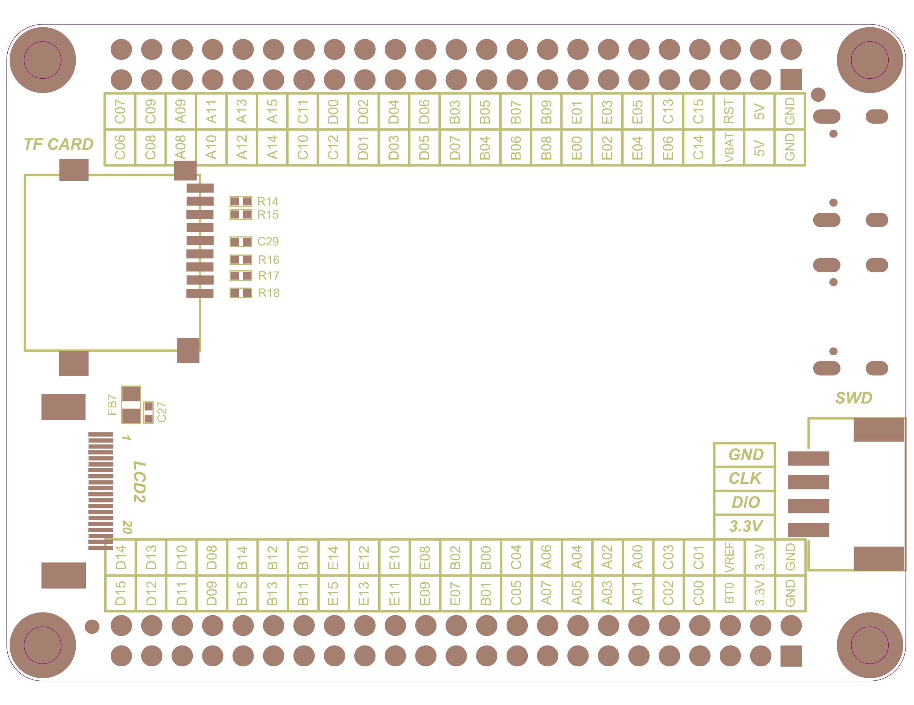

# 背面位号图 (Silkscreen Bottom)

> 来源 PDF：`2. 原理图/STM32H743VIT6 V1.2_背面位号图.pdf`

页数：1

## 第 1 页

### OCR 提取文字（位号/标注，按检测顺序）

- C07  _(conf 0.97)_
- C09  _(conf 0.98)_
- A08A09  _(conf 1.00)_
- A11  _(conf 1.00)_
- A13  _(conf 1.00)_
- A15  _(conf 1.00)_
- C11  _(conf 1.00)_
- D0O  _(conf 0.71)_
- D02  _(conf 1.00)_
- D04  _(conf 1.00)_
- D06  _(conf 1.00)_
- B03  _(conf 1.00)_
- B05  _(conf 1.00)_
- B07  _(conf 0.99)_
- B09  _(conf 1.00)_
- E01  _(conf 1.00)_
- E03  _(conf 1.00)_
- E05  _(conf 1.00)_
- C13  _(conf 1.00)_
- C15  _(conf 1.00)_
- VBATRST  _(conf 1.00)_
- GNDGND  _(conf 1.00)_
- C06  _(conf 1.00)_
- A10  _(conf 1.00)_
- A14  _(conf 1.00)_
- C10  _(conf 1.00)_
- B04  _(conf 1.00)_
- C14  _(conf 1.00)_
- TF CARD  _(conf 0.93)_
- C08  _(conf 0.97)_
- A12  _(conf 1.00)_
- C12  _(conf 1.00)_
- D01  _(conf 1.00)_
- D03  _(conf 1.00)_
- D05  _(conf 1.00)_
- D07  _(conf 1.00)_
- B06  _(conf 1.00)_
- B08  _(conf 1.00)_
- E00  _(conf 0.92)_
- E02  _(conf 1.00)_
- E04  _(conf 1.00)_
- E06  _(conf 1.00)_
- 5V  _(conf 1.00)_
- R14  _(conf 1.00)_
- R15  _(conf 1.00)_
- C29  _(conf 1.00)_
- R16  _(conf 1.00)_
- R17  _(conf 1.00)_
- R18  _(conf 1.00)_
- SWD  _(conf 0.99)_
- FB7  _(conf 0.99)_
- GND  _(conf 0.98)_
- LCD2  _(conf 1.00)_
- CLK  _(conf 1.00)_
- DIO  _(conf 0.98)_
- 20  _(conf 1.00)_
- 3.3V  _(conf 1.00)_
- D15D14  _(conf 1.00)_
- [D13  _(conf 0.86)_
- D08  _(conf 0.99)_
- B12  _(conf 1.00)_
- B10  _(conf 1.00)_
- B02  _(conf 1.00)_
- B00  _(conf 0.88)_
- BTOVREF  _(conf 1.00)_
- D10  _(conf 1.00)_
- B14  _(conf 1.00)_
- E14  _(conf 1.00)_
- E12  _(conf 1.00)_
- E10  _(conf 1.00)_
- E08  _(conf 1.00)_
- C04  _(conf 1.00)_
- A06  _(conf 1.00)_
- A04  _(conf 1.00)_
- A02  _(conf 1.00)_
- A00  _(conf 0.98)_
- C03  _(conf 0.99)_
- C01  _(conf 0.98)_
- 3.3V  _(conf 1.00)_
- GNDGND  _(conf 1.00)_
- D12  _(conf 1.00)_
- D09  _(conf 1.00)_
- B15  _(conf 1.00)_
- B13  _(conf 1.00)_
- B11  _(conf 1.00)_
- E15  _(conf 1.00)_
- E13  _(conf 1.00)_
- E09  _(conf 1.00)_
- E07  _(conf 1.00)_
- C05  _(conf 1.00)_
- A07  _(conf 1.00)_
- A05  _(conf 1.00)_
- A03  _(conf 1.00)_
- A01  _(conf 1.00)_
- C02  _(conf 0.99)_
- COO  _(conf 0.81)_
- 3.3V  _(conf 1.00)_
- B01  _(conf 0.97)_

> 共识别 98 处文字。矢量图文字以轮廓存储，OCR 可能漏识别/误识别，请以原图为准。
