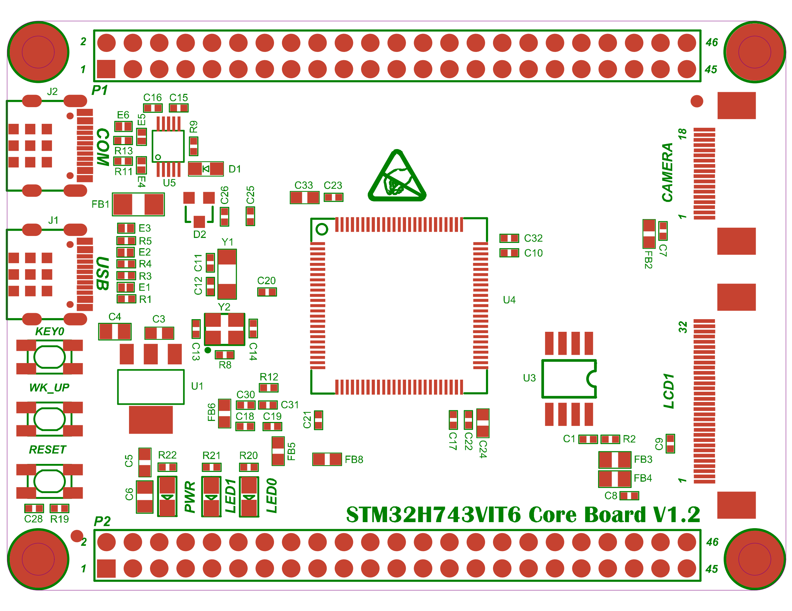

# 正面位号图 (Silkscreen Top)

> 来源 PDF：`2. 原理图/STM32H743VIT6 V1.2_正面位号图.pdf`

页数：1

## 第 1 页

### OCR 提取文字（位号/标注，按检测顺序）

- 46  _(conf 1.00)_
- 45  _(conf 1.00)_
- J2  _(conf 1.00)_
- P1  _(conf 1.00)_
- C16  _(conf 1.00)_
- C15  _(conf 0.99)_
- E6  _(conf 0.98)_
- COM  _(conf 0.98)_
- R13  _(conf 1.00)_
- CAMERA  _(conf 0.98)_
- R11  _(conf 1.00)_
- U5  _(conf 1.00)_
- C33  _(conf 1.00)_
- C23  _(conf 1.00)_
- C26  _(conf 0.88)_
- 52  _(conf 0.55)_
- FB1  _(conf 1.00)_
- E3  _(conf 0.99)_
- REARER  _(conf 0.71)_
- D2  _(conf 1.00)_
- C32  _(conf 1.00)_
- Y1  _(conf 0.98)_
- C10  _(conf 1.00)_
- FB2  _(conf 0.99)_
- USB  _(conf 1.00)_
- C11  _(conf 1.00)_
- C12  _(conf 1.00)_
- C20  _(conf 1.00)_
- U4  _(conf 1.00)_
- 4  _(conf 0.96)_
- C3  _(conf 1.00)_
- 23  _(conf 0.62)_
- KEYO  _(conf 0.99)_
- C14  _(conf 1.00)_
- 3  _(conf 1.00)_
- R8  _(conf 1.00)_
- R12  _(conf 1.00)_
- U3  _(conf 1.00)_
- LCD1  _(conf 1.00)_
- WK_UP  _(conf 1.00)_
- C30  _(conf 0.99)_
- FB6  _(conf 1.00)_
- C31  _(conf 1.00)_
- C18  _(conf 1.00)_
- C1  _(conf 0.99)_
- R2  _(conf 1.00)_
- FB5  _(conf 1.00)_
- RESET  _(conf 0.99)_
- C24  _(conf 0.84)_
- R22  _(conf 1.00)_
- R21  _(conf 1.00)_
- 5  _(conf 0.96)_
- R20  _(conf 1.00)_
- FB8  _(conf 1.00)_
- FB3  _(conf 1.00)_
- FB4  _(conf 1.00)_
- PWR  _(conf 1.00)_
- LED1  _(conf 0.90)_
- LEDO  _(conf 0.96)_
- C6  _(conf 0.99)_
- C8  _(conf 0.96)_
- STM32H743VIT6C0re  _(conf 0.96)_
-  Board V1.2  _(conf 0.98)_
- C28R19  _(conf 1.00)_
- P2  _(conf 1.00)_
- 46  _(conf 1.00)_
- 45  _(conf 1.00)_

> 共识别 67 处文字。矢量图文字以轮廓存储，OCR 可能漏识别/误识别，请以原图为准。
